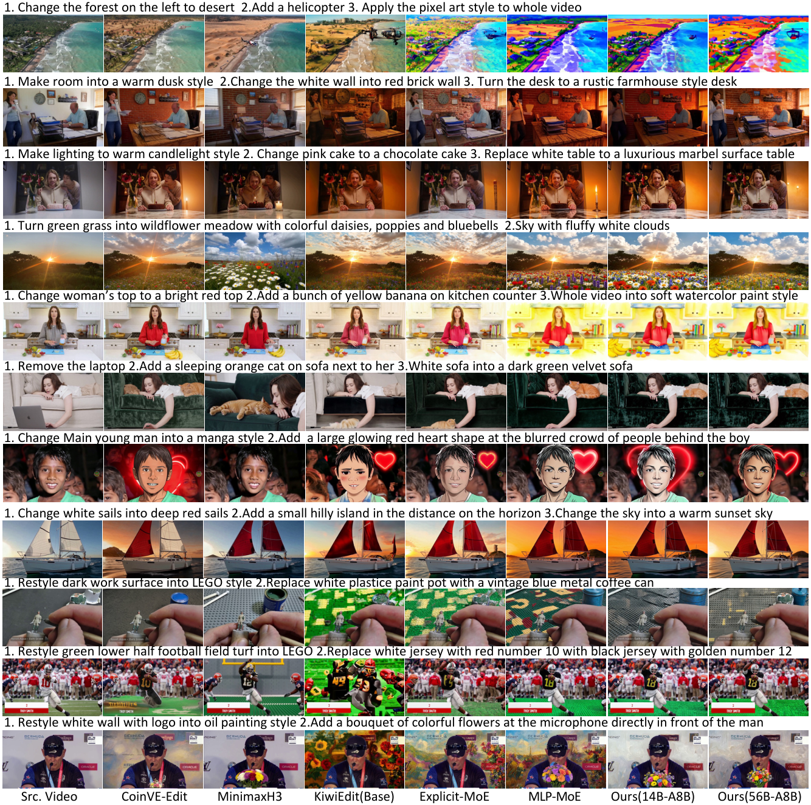

# Video-Editor-MoE

<p align="center">
  &nbsp;&nbsp;&nbsp;&nbsp;&nbsp;&nbsp;
  
</p>

<p align="center">
  <a href="https://arxiv.org/abs/2611.03043"></a>&nbsp;
  <a href="https://arxiv.org/html/2611.03043"></a>&nbsp;
  <a href="https://huggingface.co/Massyzs"></a>
</p>

**Video-Editor-MoE** is a mixture-of-experts video editing model developed by Tencent (Tencent Video) and the National University of
Singapore. It edits videos from text instructions, including complex multi-step instructions (several edits of different kinds in one
sentence), by adding experts to a video diffusion transformer that specialise in different kinds of edits. Paper:
[VideoEditor-MoE: Scaling Complex Video Editing with Mixture of Experts](https://arxiv.org/abs/2611.03043) ([HTML](https://arxiv.org/html/2611.03043)).

We release all parameters of every model (the 14B and 56B editors and the two baselines), the long-video versions (121 / 81 frames),
fast-inference scripts for two GPUs and low-GPU-memory scripts that run the 14B model on a 40 GB GPU and the 56B model on a single GPU,
together with the training code. See [Inference](#inference) for the ready-made launchers.

## Visual comparison

Multi-step editing instructions on the benchmark videos: source video, CoinVE-Edit, MiniMax-H3, Kiwi-Edit (base), Explicit-MoE, MLP-MoE,
Ours 14B-A8B and Ours 56B-A8B (one frame per clip; [PDF version](assets/visual_comparison.pdf)).

<p align="center"></p>

## Models

All models start from **[Kiwi-Edit](https://github.com/showlab/Kiwi-Edit)** (5B, instruct-only; a Wan2.2-TI2V-5B video DiT conditioned
on a Qwen2.5-VL-based MLLM encoder) and add experts that specialise the DiT for different kinds of edits. This repository contains the
training and inference code for four models:

| Model | Code | Idea | DiT parameters | Weights |
|---|---|---|---|---|
| **explicit-moe** | [`scripts/moe/explicit-moe`](scripts/moe/explicit-moe) | frozen Kiwi-Edit DiT + 5 explicit task experts (LoRA, one per edit category); a router head picks the expert of each sub-instruction and 14 trainable fusion layers merge the expert streams | 5.0B frozen + 2.1B | [Massyzs/explicit-moe](https://huggingface.co/Massyzs/explicit-moe) |
| **mlp-moe** | [`scripts/moe/mlp-moe`](scripts/moe/mlp-moe) | FFN of 14 DiT blocks replaced by a 12-expert top-3 MoE, trained end to end | 18.6B | [Massyzs/mlp-moe](https://huggingface.co/Massyzs/mlp-moe) |
| **videoeditor-14b** | [`scripts/moe/videoeditor-14b`](scripts/moe/videoeditor-14b) | FFN **and** self-attention key/value of 14 blocks as 7-expert top-3 MoEs | 14.0B (~8B active) | [Massyzs/videoeditor-14b](https://huggingface.co/Massyzs/videoeditor-14b) |
| **videoeditor-56b** | [`scripts/moe/videoeditor-56b`](scripts/moe/videoeditor-56b) | videoeditor-14b scaled to 35 experts per MoE layer (7 sources x 5 noised copies) | 55.9B (~8B active) | [Massyzs/videoeditor-56b](https://huggingface.co/Massyzs/videoeditor-56b) |
| **videoeditor-14b-long** | [`scripts/moe/videoeditor-14b`](scripts/moe/videoeditor-14b) | videoeditor-14b continued on the same data re-cut to 121 / 81 frames per sample (half an epoch) | 14.0B (~8B active) | [Massyzs/videoeditor-14b-long](https://huggingface.co/Massyzs/videoeditor-14b-long) |
| **videoeditor-56b-long** | [`scripts/moe/videoeditor-56b`](scripts/moe/videoeditor-56b) | videoeditor-56b continued on the same data re-cut to 121 / 81 frames per sample | 55.9B (~8B active) | [Massyzs/videoeditor-56b-long](https://huggingface.co/Massyzs/videoeditor-56b-long) |

The two `-long` variants use the same code and inference scripts as their base models; pass `--num_frames 121` (or 81) for long inputs.

The frozen components shared by all models (DiT base, MLLM encoder, query tokens/connector, VAE) are in
[Massyzs/kiwi-edit-5b-instruct-only-videoxfun](https://huggingface.co/Massyzs/kiwi-edit-5b-instruct-only-videoxfun).
All weight repositories are gated: request access on the model page.

## Installation

```bash
conda create -n videoeditor python=3.10 -y && conda activate videoeditor
pip install -r requirements.txt
# optional: pip install flash-attn --no-build-isolation
```

Tested on NVIDIA H100 80GB with CUDA 12.8.

## Weights

Choose a working directory `BASE_DIR` and download the shared base components:

```bash
huggingface-cli login     # after your access request has been approved
huggingface-cli download Massyzs/kiwi-edit-5b-instruct-only-videoxfun \
    --local-dir $BASE_DIR/ckpt/kiwi-edit-instruct-only-videoxfun
```

Each model repository ships its weights as a tar.gz stream split into 20 GB chunks (optimizer state is not included). After extraction the layout under `BASE_DIR` is:

```
$BASE_DIR/ckpt/kiwi-edit-instruct-only-videoxfun/   shared base components (DiT base, VAE, qwen/ MLLM encoder, moe_expert_init.safetensors)
$BASE_DIR/ckpt/<model>/                              one folder per downloaded model, e.g. videoeditor-14b/, videoeditor-14b-long/, explicit-moe/
```

For example, videoeditor-14b (replace the name for any other model, e.g. `videoeditor-14b-long`):

```bash
huggingface-cli download Massyzs/videoeditor-14b --local-dir $BASE_DIR/hf/videoeditor-14b
cd $BASE_DIR/hf/videoeditor-14b
cat videoeditor-14b.tar.gz.part-* | tar -xzf - -C $BASE_DIR/ckpt/     # -> $BASE_DIR/ckpt/videoeditor-14b/
cp SHA256SUMS.contents $BASE_DIR/ckpt/ && (cd $BASE_DIR/ckpt && sha256sum -c SHA256SUMS.contents)   # optional check
```

## Inference

### Quick start: launcher scripts

videoeditor-14b and videoeditor-56b ship three ready-made launchers each. Open the script, edit the configuration block at the top
(`BASE_DIR`, `CKPT`, `SRC_VIDEO`, `PROMPT` or `PROMPTS`, `NAME`, `OUT_DIR`, GPU ids), then run it from anywhere:

```bash
bash scripts/moe/videoeditor-14b/infer.sh            # default: one 80 GB GPU
bash scripts/moe/videoeditor-14b/infer_lowmem.sh     # low memory: one 40 GB GPU, same speed
bash scripts/moe/videoeditor-14b/infer_fast.sh       # fast: two 80 GB GPUs
bash scripts/moe/videoeditor-56b/infer.sh            # default: two 80 GB GPUs
bash scripts/moe/videoeditor-56b/infer_lowmem.sh     # low memory: one 80 GB or one 40 GB GPU
bash scripts/moe/videoeditor-56b/infer_fast.sh       # fast: two 80 GB GPUs
```

| script | what it runs | GPUs | time per 49-frame video (H100) | host RAM |
|---|---|---|---|---|
| `videoeditor-14b/infer.sh` | `moe_v3_1_infer.py` | 1 x 80 GB | 35 s | 30 GB |
| `videoeditor-14b/infer_lowmem.sh` | `moe_v3_1_infer.py --low_mem 1 --reserve_gib 10` | 1 x 40 GB (peak 35 GiB) | 35 s | 45 GB |
| `videoeditor-14b/infer_fast.sh` | `moe_v3_1_infer_fast.py --moe_impl grouped --dp_cfg 1 --cuda_graph 1` | 2 x 80 GB | 30 s | 30 GB |
| `videoeditor-56b/infer.sh` | `moe_v3_2_infer.py --gpus 2` | 2 x 80 GB | 46 s | 120 GB while loading |
| `videoeditor-56b/infer_lowmem.sh` | `moe_v3_2_infer.py --gpus 1 --low_mem 1` | 1 x 80 GB (peak 71 GiB) / 1 x 40 GB (peak 28 GiB) | 6 min / 10 min | 75 GB / 125 GB |
| `videoeditor-56b/infer_fast.sh` | `moe_v3_2_infer_fast.py --gpus 2 --moe_impl grouped` | 2 x 80 GB | 37 s | 120 GB while loading |

All six produce the same edit for the same weights, seed and settings (the fast scripts up to bf16 rounding, the low-memory mode up to the
pipeline's run-to-run GPU variation). `EXTRA_ARGS` in the configuration block passes any further option of the python script (sampling steps,
seed, CFG scale, ...); the sections below and the per-model READMEs describe them. Every model edits one source video from a text instruction. Inputs: `--src_video` is any mp4 (the first frames are used, resized/cropped to
480x832; 49 frames by default, `--num_frames 121` or `81` for the `-long` models), `--prompt` is the instruction (or `--prompts "step 1 ||| step 2"`
for a multi-step edit). Outputs go to `--out_dir`: `<name>.mp4` (16 fps) and lossless PNG frames in `frames/<name>/`. Run from the repository root:

```bash
python scripts/moe/videoeditor-14b/moe_v3_1_infer.py \
    --base_dir $BASE_DIR --ckpt $BASE_DIR/ckpt/videoeditor-14b \
    --src_video input.mp4 --prompt "Replace the red car with a blue truck" \
    --name edited --out_dir outputs/
# multi-step instruction: --prompts "Remove the dog ||| Convert to oil painting style"
```

| Model | Inference script | GPUs |
|---|---|---|
| explicit-moe | `scripts/moe/explicit-moe/moe_v2_infer.py` | 1 x 80 GB |
| mlp-moe | `scripts/moe/mlp-moe/moe_v3_infer.py` | 1 x 80 GB |
| videoeditor-14b | `scripts/moe/videoeditor-14b/moe_v3_1_infer.py` | 1 x 80 GB, or 1 x 40 GB with `--low_mem 1` (see [Low-memory inference](#low-memory-inference)) |
| videoeditor-56b | `scripts/moe/videoeditor-56b/moe_v3_2_infer.py --gpus 2` | 2 x 80 GB (the DiT is split across both), or 1 x 80 GB / 1 x 40 GB with `--gpus 1 --low_mem 1` |
| videoeditor-14b, fast | `scripts/moe/videoeditor-14b/moe_v3_1_infer_fast.py --moe_impl grouped --dp_cfg 1 --cuda_graph 1` | 2 x 80 GB (see [Fast inference](#fast-inference)) |
| videoeditor-56b, fast | `scripts/moe/videoeditor-56b/moe_v3_2_infer_fast.py --gpus 2 --moe_impl grouped` | 2 x 80 GB |
| videoeditor-14b-long | `scripts/moe/videoeditor-14b/moe_v3_1_infer.py --num_frames 121` | 1 x 80 GB |
| videoeditor-56b-long | `scripts/moe/videoeditor-56b/moe_v3_2_infer.py --gpus 2 --num_frames 121` | 2 x 80 GB |

Defaults: 50 sampling steps, sigma shift 5, text classifier-free guidance with scale 3 (applied on the first 60% of the steps for
mlp-moe / videoeditor-14b / videoeditor-56b, on all steps for explicit-moe). The output is `<out_dir>/<name>.mp4` plus lossless
PNG frames; the MoE models also write per-layer expert-routing maps. Each script also has a batch mode over a JSON case list.
See the README in each model directory for all options.

### Fast inference

`moe_v3_1_infer_fast.py` (videoeditor-14b) and `moe_v3_2_infer_fast.py` (videoeditor-56b) are copies of the inference scripts with the same
command line plus speed options. They build the DiT from `*_model_fast.py` / `wan_transformer3d_kiwi_moe_v3_*_fast.py`, copies of the model
files with an inference-only fused expert path; the original scripts and model files are unchanged, and the weights are the same.

| model | command | GPUs | DiT time per video | end to end per video |
|---|---|---|---|---|
| videoeditor-56b | `moe_v3_2_infer_fast.py --gpus 2 --moe_impl grouped` | 2 x 80 GB | 37.0 s -> 26.1 s | 45.8 s -> 36.9 s |
| videoeditor-14b | `MOE_ATTN_BACKEND=fa2 moe_v3_1_infer_fast.py --moe_impl grouped --dp_cfg 1 --cuda_graph 1` | 2 x 80 GB | 26.1 s -> 16.5 s | 35.3 s -> 30.2 s |

- `--fuse_experts 1` (default) stacks the expert weights of each MoE layer into one contiguous tensor (views, no extra memory) and `--fuse_kv 1`
  (default) runs each expert's key and value projections as one GEMM. Both are bit-identical to the original.
- `--moe_impl grouped` runs all experts of a layer as one grouped GEMM over the tokens sorted by expert (`torch._grouped_mm`, PyTorch >= 2.8),
  without host synchronisation. The expert bias is added after the bf16 GEMM, the only numerical difference to the original (one extra bf16
  rounding; the frame-level PSNR to the original run, 41-48 dB, equals the original pipeline's own run-to-run variation).
- videoeditor-56b: `--cfg_pipeline 1` (default) issues the conditional and unconditional CFG branches on separate CUDA stream pairs so that one
  branch's first shard overlaps the other branch's second shard (bit-identical to sequential); `--cfg_batch 1` runs both branches as one batch-2
  forward instead.
- videoeditor-14b: `--dp_cfg 1` puts a replica of the DiT on the second GPU and runs the unconditional CFG branch there, concurrently with the
  conditional branch; `--cuda_graph 1` captures the DiT forward in a CUDA graph per case and branch (needs `--moe_impl grouped` and
  `MOE_ATTN_BACKEND=fa2`). Both are bit-identical to the sequential grouped run. On one GPU the 14B forward is compute-bound and the
  single-GPU options gain at most ~5%.

Timings: H100 80GB, 49 x 480 x 832, 50 steps, text CFG 3 on the first 60% of the steps (80 DiT forwards per video); end to end includes the
MLLM and VAE and writing the PNG frames. On the 95-case benchmark the judge scores of the fast and original runs agree within the judge's own
noise (identical per-requirement execution verdicts for 96-97% of the edit requirements).

### Low-memory inference

`moe_v3_1_infer.py` and `moe_v3_2_infer.py` have an opt-in `--low_mem 1` mode for GPUs that cannot hold the whole model (the default mode is
unchanged). The MLLM encoder (7.1 GiB) then stays in pinned host memory and is copied to the GPU only while a case is encoded. The dense DiT
blocks, embeddings and head are resident; as many MoE blocks as fit into (free GPU memory - `--reserve_gib`, default 12) stay resident, and the
remaining MoE blocks are streamed from pinned host memory block by block through two GPU slots, the next block being prefetched on a side
stream while the current one computes. Streaming is done per block, not per expert, because every expert of a layer is used in every forward
pass (top-3 routing over 5,070 tokens). The outputs are those of the default mode up to the pipeline's run-to-run variation (same kernels,
same data). Speed is bound by the host-to-GPU copies: each streamed videoeditor-56b block moves 7.1 GiB per DiT forward (80 forwards per video),
each videoeditor-14b block 1.5 GiB. Host RAM: the bf16 model plus one pinned 8 GiB buffer per streamed block and 8 GiB for the MLLM
(videoeditor-56b resident set: 75 GB with 6 resident blocks, 125 GB with all 14 streamed, 105 GB peak while loading).

| model | command | GPU | MoE blocks resident / streamed | peak GPU memory | time per video |
|---|---|---|---|---|---|
| videoeditor-56b | `moe_v3_2_infer.py --gpus 1 --low_mem 1` | 1 x 80 GB | 6 / 8 | 70.8 GiB | 351-356 s (about 6 min; two-GPU default mode: 46 s) |
| videoeditor-56b | `moe_v3_2_infer.py --gpus 1 --low_mem 1` | 1 x 40 GB | 0 / 14 | 28.3 GiB | 600-611 s (about 10 min) |
| videoeditor-14b | `moe_v3_1_infer.py --low_mem 1 --reserve_gib 10` | 1 x 40 GB | 14 / 0 | 35.2 GiB | 33-37 s (same as the default mode on 80 GB) |
| videoeditor-14b | `moe_v3_1_infer.py --low_mem 1` | 1 x 40 GB | 11 / 3 | 33.7 GiB | 49-56 s |

Measured on H100 80GB with the host-to-GPU copy bandwidth of our server (14 GB/s from pinned memory); the 40 GB rows use
`--emulate_gpu_gib 38`, which caps the PyTorch allocator at 38 GiB (without `--low_mem 1` the 14B run stops with an out-of-memory error at
that cap; the default 14B run peaks at 39.1 GiB). `--resident_blocks N` overrides the automatic choice, `--numa_bind 1` (default) binds the
process to the CPUs of the GPU's NUMA node before pinning host memory, and `--min_free_gib` defaults to 30 (videoeditor-56b) or 20 (videoeditor-14b) in this mode. Starting takes a few
minutes longer than the default mode because the streamed blocks are copied into pinned memory.

## Training

Training data formats are described in [`docs/DATA.md`](docs/DATA.md). Each model directory has a multi-node launcher
(`train_multinode.sh`) and a single-node smoke test (`train_smoke.sh`). Edit the configuration block at the top of the launcher
(`BASE_DIR`, `DATASET_BASE`, `MASTER_ADDR`, `NUM_NODES`, ...) and start it on every node with its node rank:

```bash
bash scripts/moe/videoeditor-14b/train_multinode.sh 0     # on node 0; use 1, 2, ... on the other nodes
```

| Model | Setup used for the released weights | Starting point |
|---|---|---|
| explicit-moe | 2 nodes x 8 GPUs, batch 32 | frozen Kiwi-Edit + the five LoRA experts and the initial router head (both in the explicit-moe package) |
| mlp-moe | 3 nodes x 8 GPUs, batch 192, DeepSpeed ZeRO-3 | merged expert init built by `merge_experts.py` |
| videoeditor-14b | 3 nodes x 8 GPUs, batch 192, DeepSpeed ZeRO-3 | merged expert init built by `merge_experts_v3_1.py` |
| videoeditor-56b | 3 nodes x 8 GPUs, batch 120, DeepSpeed ZeRO-3 with CPU-offloaded optimizer | the videoeditor-14b expert init, 5 noised copies per expert |

Long-video training: dataset records may carry `num_frames_bucket` (121 or 81); set `NUM_FRAMES=121` in the launcher and the trainer builds
frame-count-homogeneous batches (see `docs/DATA.md`). The released long-video weights continue from the released checkpoints with the same launchers.

The merged expert initialisations combine the category LoRA experts (released with explicit-moe) with a direct full fine-tune
of Kiwi-Edit that is not released; the model READMEs explain how to fine-tune from the released checkpoints instead.

## Repository layout

```
config/wan2.2/wan_civitai_5b.yaml   DiT/VAE configuration
videox_fun/                         model, data and distributed utilities (from VideoX-Fun) + Kiwi-Edit modules
videox_fun/moe_common/              MLLM encoder wrapper, datasets and helpers shared by the four models
scripts/moe/<model>/                training, inference and test scripts of each model (see its README)
```

## Acknowledgements and license

This code builds on [VideoX-Fun](https://github.com/aigc-apps/VideoX-Fun) (Apache-2.0), [Kiwi-Edit](https://github.com/showlab/Kiwi-Edit) (MIT)
and [Wan2.2](https://github.com/Wan-Video/Wan2.2) (Apache-2.0); see `NOTICE`. The code is released under the Apache License 2.0 (`LICENSE`).
